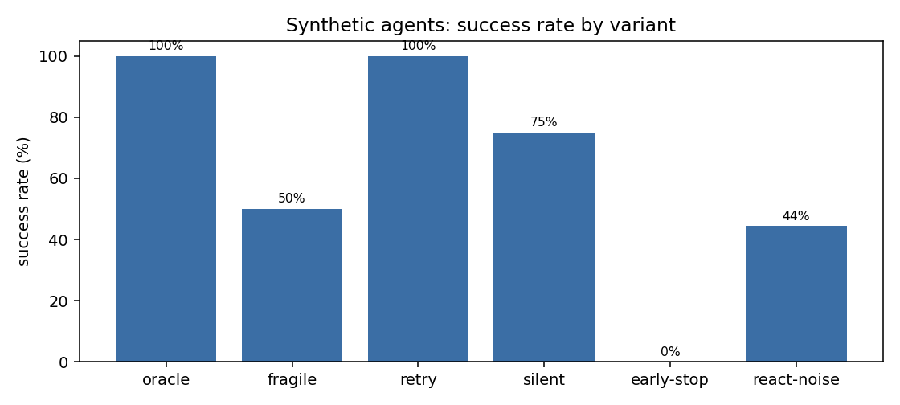

# AgentLab 对照实验

> 所有 agent 均为 scripted 或 mock 模型：本表用于验证评测流水线能区分行为，**不是模型能力结论**。

| 变体 | 说明 | episodes | SR | 95% CI | RRS | 平均 calls | 平均 ES | REBOUND |
|---|---|---|---|---|---|---|---|---|
| `oracle` | 脚本化 oracle：按解重放 | 36 | 100.0% | 90–100% | 100.0% | 3.0 | 1.0 | 1.000 |
| `fragile` | 遇错即放弃（不恢复） | 8 | 50.0% | 22–78% | 0.0% | 1.0 | 0.5 | 0.450 |
| `retry` | 失败后重试同一动作 | 8 | 100.0% | 68–100% | 100.0% | 2.5 | 0.8512 | 0.970 |
| `silent` | 跳过澄清直接猜 | 8 | 75.0% | 41–93% | 100.0% | 1.5 | 0.75 | 0.700 |
| `early-stop` | 提前交卷（少做最后一步） | 8 | 0.0% | 0–32% | 0.0% | 0.75 | 0.0 | 0.150 |
| `react-noise` | ReAct + mock 模型 + 30% 行为噪声 | 36 | 44.4% | 30–60% | 50.0% | 3.06 | 0.4375 | 0.458 |

## 恢复 / 漂移分解

| 变体 | clean SR | fault SR | drift SR | recovery lift |
|---|---|---|---|---|
| `oracle` | 100.0% | 100.0% | 100.0% | +0.000 |
| `fragile` | 100.0% | 0.0% | 0.0% | -1.000 |
| `retry` | 100.0% | 100.0% | 100.0% | +0.000 |
| `silent` | 50.0% | 100.0% | 100.0% | +0.500 |
| `early-stop` | 0.0% | 0.0% | 0.0% | +0.000 |
| `react-noise` | 43.8% | 50.0% | 50.0% | +0.062 |

## 失败模式

| 变体 | 主要失败模式 |
|---|---|
| `oracle` | - |
| `fragile` | gave_up=4 |
| `retry` | - |
| `silent` | no_attempt=2 |
| `early-stop` | fault_unrecovered=4, no_attempt=4 |
| `react-noise` | wrong_output=18, fault_unrecovered=2 |

## 读法

- `oracle` 是上界（按任务解重放），任何 <100% 都说明任务本身或判分有问题，应先修任务。
- `fragile` 与 `retry` 的差值近似「恢复行为」的贡献；`silent` 验证澄清质量 CQ 与成功率解耦。
- `react-noise` 用 30% 丢步/替换动作模拟不完美策略，用于验证 ReAct 文本协议与轨迹记录链路。
- Wilson 区间在 n 很小时会非常宽，不要把个位数 episode 的差值当结论。

## 明细

每个变体的完整报告在 `experiments/results/exp-<name>/report.md`。

