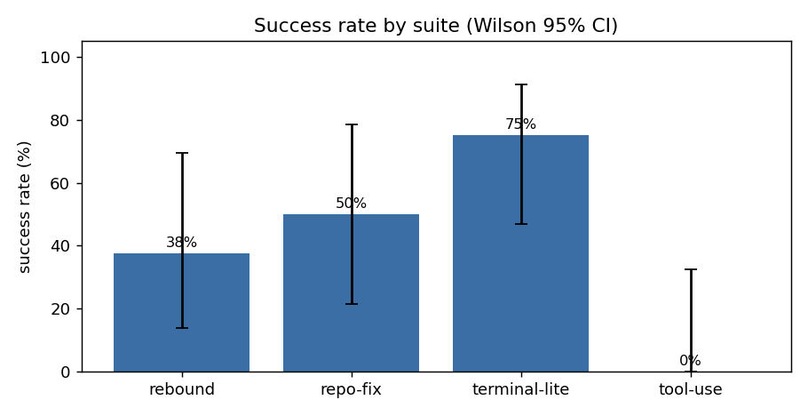
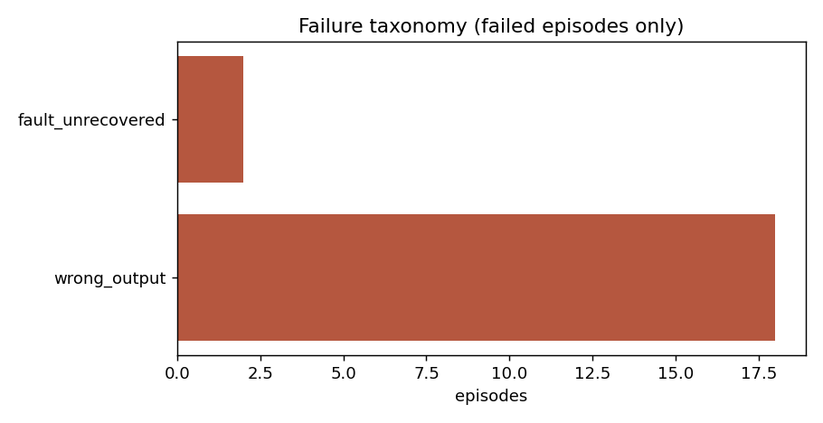
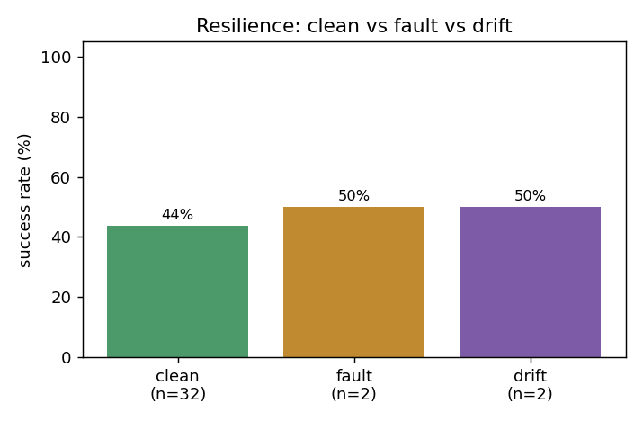
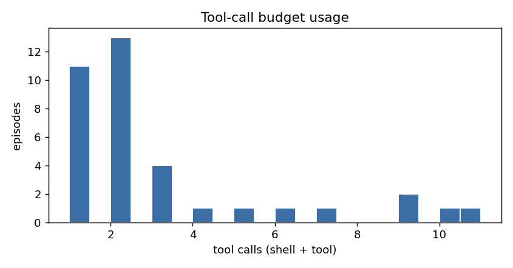

# AgentLab 评测报告：`exp-react-noise`

生成时间：2026-10-26 23:00:03  
Agent：`react` · 模型：`mock:0.3` · 样本/task：2 · episodes：36  

## 1. 总览

| 指标 | 值 |
|---|---|
| Episodes | 36 |
| 成功率 SR | **44.4%** (Wilson 95% CI 29.5% – 60.4%) |
| 平均动作数 | 5.08 |
| 平均 tool calls | 3.06 |
| 平均效率分 ES | 0.4375 |
| 平均 tokens | 4496.7 |
| 平均成本 | $0.0 |
| pass@k | pass@2=0.7222 |

## 2. 分环境

| Suite | n | SR | 95% CI | 平均 calls | 平均 ES | p50 耗时 |
|---|---|---|---|---|---|---|
| `rebound` | 8 | 37.5% | 13.7%–69.4% | 1.88 | 0.3542 | 371 ms |
| `repo-fix` | 8 | 50.0% | 21.5%–78.5% | 1.12 | 0.5 | 1507 ms |
| `terminal-lite` | 12 | 75.0% | 46.8%–91.1% | 2.08 | 0.7431 | 684 ms |
| `tool-use` | 8 | 0.0% | 0.0%–32.4% | 7.62 | 0.0 | 366 ms |

## 3. 分难度

| 难度 | n | SR | 平均 calls | 平均 ES |
|---|---|---|---|---|
| medium | 16 | 43.8% | 2.56 | 0.4375 |
| easy | 8 | 50.0% | 3.25 | 0.4792 |
| hard | 12 | 41.7% | 3.58 | 0.4097 |

## 4. 韧性与 REBOUND 综合分

| 轴 | n | 成功率 |
|---|---|---|
| clean | 32 | 43.8% |
| fault | 2 | 50.0% |
| drift | 2 | 50.0% |

恢复率增益 recovery_lift = RRS − clean_SR = **+0.0625**

REBOUND 综合分 = 0.40·SR + 0.25·RRS + 0.20·ES + 0.15·CQ = **0.4583**  (SR=0.375, RRS=0.5, ES=0.3542, CQ=0.75)

> 权重定义见 `docs/gaps-and-proposal.md`；CQ 只在含 ambiguity 的任务上计算。

## 5. 失败分类

| 模式 | episodes | 占比 |
|---|---|---|
| `fault_unrecovered` | 2 | 10% |
| `wrong_output` | 18 | 90% |

## 6. 逐任务

| Task | Suite | 难度 | n | SR | calls | ES | 失败检查 | 失败模式 |
|---|---|---|---|---|---|---|---|---|
| `rb-ambiguity-port` | rebound | medium | 2 | 0.0% | 1.0 | 0.0 | clarification_done, manifest_content, manifest_exists | wrong_output |
| `rb-budget-oneshot` | rebound | medium | 2 | 50.0% | 1.0 | 0.5 | manifest_content, merged_content, merged_exists | wrong_output |
| `rb-drift-config` | rebound | medium | 2 | 50.0% | 3.0 | 0.5 | config_restored, deploy_content, deploy_exists | fault_unrecovered |
| `rb-fault-retry` | rebound | easy | 2 | 50.0% | 2.5 | 0.4167 | summary_exists, summary_values | fault_unrecovered |
| `repo-csv-ledger` | repo-fix | hard | 2 | 50.0% | 1.0 | 0.5 | export_order_ints, parse_quoted_comma, sign_and_rounding | wrong_output |
| `repo-invoice-round` | repo-fix | medium | 2 | 50.0% | 1.0 | 0.5 | all_items_and_tax, rounding_half_up | wrong_output |
| `repo-log-rotate` | repo-fix | medium | 2 | 50.0% | 1.0 | 0.5 | keep_count_and_order, size_cap, tie_break_stability | wrong_output |
| `repo-retry-engine` | repo-fix | hard | 2 | 50.0% | 1.5 | 0.5 | attempt_cap, summary_order | wrong_output |
| `term-backup-manifest` | terminal-lite | medium | 2 | 100.0% | 2.0 | 1.0 | - | - |
| `term-config-migrate` | terminal-lite | medium | 2 | 50.0% | 2.0 | 0.5 | config_json_content, config_json_exists | wrong_output |
| `term-csv-clean` | terminal-lite | easy | 2 | 100.0% | 2.0 | 1.0 | - | - |
| `term-dup-audit` | terminal-lite | hard | 2 | 100.0% | 2.0 | 1.0 | - | - |
| `term-log-report` | terminal-lite | easy | 2 | 50.0% | 2.0 | 0.5 | report_values | wrong_output |
| `term-port-conflict` | terminal-lite | hard | 2 | 50.0% | 2.5 | 0.4583 | report_json_content, report_json_exists, summary_content | wrong_output |
| `tool-data-reconcile` | tool-use | hard | 2 | 0.0% | 4.5 | 0.0 | billing_called, recon_answer, systems_and_tickets | wrong_output |
| `tool-expense-policy` | tool-use | hard | 2 | 0.0% | 10.0 | 0.0 | lookups_and_tickets | wrong_output |
| `tool-refund-approval` | tool-use | medium | 2 | 0.0% | 9.5 | 0.0 | inputs_and_side_effects, refund_answer, refund_applied | wrong_output |
| `tool-ticket-triage` | tool-use | easy | 2 | 0.0% | 6.5 | 0.0 | tickets_created, tool_usage_complete | wrong_output |

## 7. 图表









## 8. 复现方式

```bash
python -m agentlab run --suite <suite> --agent react --model mock:0.3 --samples 2 --out experiments\results
```

口径说明：

- SR = `status==success 且 verdict.success` 的 episode 占比；success 要求全部 `required` 检查通过且加权分 ≥ `pass_threshold`。
- pass@k 使用无偏估计 `1 − C(n−c,k)/C(n,k)`，按 task 计算后取平均。
- ES = `success × clip(1 − (used−oracle)/(cap−oracle), 0, 1)`；故障/超预算 episode 的 ES 为 0。
- 缺失值（如无 fault episode 时的 RRS）在聚合中记为 `null`，不参与综合分。

产物：`results.jsonl`（逐 episode 摘要）、`episodes/`（完整轨迹）、`workspaces/`（终态文件，便于人工复核）、`summary.json`、`run_meta.json`（含任务指纹，可校验任务是否被改动）。
