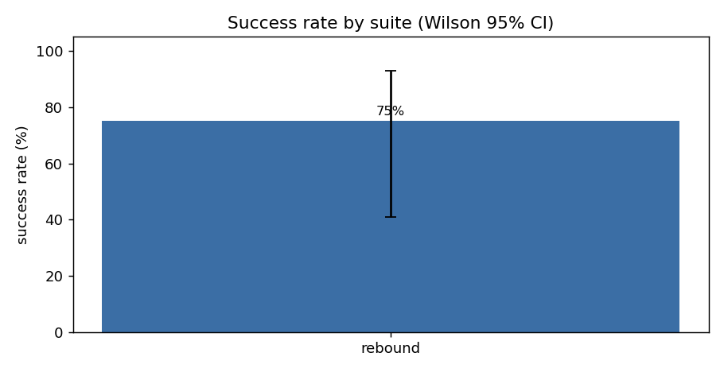
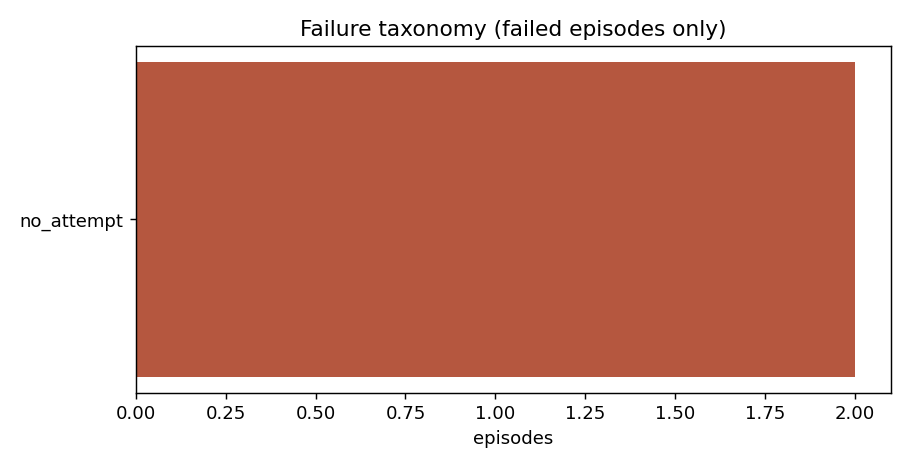
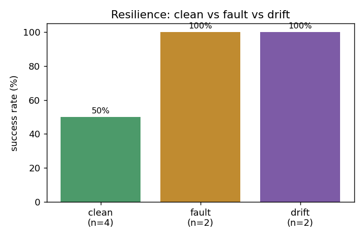
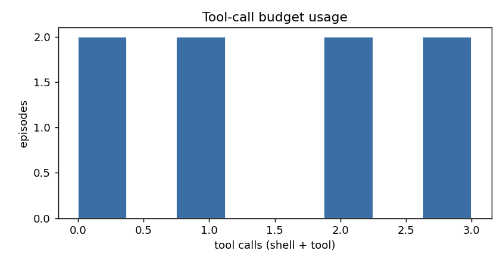

# AgentLab 评测报告：`exp-silent`

生成时间：2026-10-26 22:59:54  
Agent：`scripted` · 模型：`mock` · 样本/task：2 · episodes：8  

> ⚠️ **本报告是 harness 自检结果，不是模型能力结论。** agent 为 scripted/mock，分数只说明流水线能区分行为、判分与指标计算正确。真实模型评测需以 `--agent react --model <真实模型>` 运行。

## 1. 总览

| 指标 | 值 |
|---|---|
| Episodes | 8 |
| 成功率 SR | **75.0%** (Wilson 95% CI 40.9% – 92.8%) |
| 平均动作数 | 3.5 |
| 平均 tool calls | 1.5 |
| 平均效率分 ES | 0.75 |
| 平均 tokens | 0.0 |
| 平均成本 | $0.0 |
| pass@k | pass@2=0.75 |

## 2. 分环境

| Suite | n | SR | 95% CI | 平均 calls | 平均 ES | p50 耗时 |
|---|---|---|---|---|---|---|
| `rebound` | 8 | 75.0% | 40.9%–92.8% | 1.5 | 0.75 | 344 ms |

## 3. 分难度

| 难度 | n | SR | 平均 calls | 平均 ES |
|---|---|---|---|---|
| medium | 6 | 66.7% | 1.33 | 0.6667 |
| easy | 2 | 100.0% | 2.0 | 1.0 |

## 4. 韧性与 REBOUND 综合分

| 轴 | n | 成功率 |
|---|---|---|
| clean | 4 | 50.0% |
| fault | 2 | 100.0% |
| drift | 2 | 100.0% |

恢复率增益 recovery_lift = RRS − clean_SR = **+0.5000**

REBOUND 综合分 = 0.40·SR + 0.25·RRS + 0.20·ES + 0.15·CQ = **0.7**  (SR=0.75, RRS=1.0, ES=0.75, CQ=0.0)

> 权重定义见 `docs/gaps-and-proposal.md`；CQ 只在含 ambiguity 的任务上计算。

## 5. 失败分类

| 模式 | episodes | 占比 |
|---|---|---|
| `no_attempt` | 2 | 100% |

## 6. 逐任务

| Task | Suite | 难度 | n | SR | calls | ES | 失败检查 | 失败模式 |
|---|---|---|---|---|---|---|---|---|
| `rb-ambiguity-port` | rebound | medium | 2 | 0.0% | 0.0 | 0.0 | clarification_done | no_attempt |
| `rb-budget-oneshot` | rebound | medium | 2 | 100.0% | 1.0 | 1.0 | - | - |
| `rb-drift-config` | rebound | medium | 2 | 100.0% | 3.0 | 1.0 | - | - |
| `rb-fault-retry` | rebound | easy | 2 | 100.0% | 2.0 | 1.0 | - | - |

## 7. 图表









## 8. 复现方式

```bash
python -m agentlab run --suite rebound --agent scripted --model mock --samples 2 --out experiments\results
```

口径说明：

- SR = `status==success 且 verdict.success` 的 episode 占比；success 要求全部 `required` 检查通过且加权分 ≥ `pass_threshold`。
- pass@k 使用无偏估计 `1 − C(n−c,k)/C(n,k)`，按 task 计算后取平均。
- ES = `success × clip(1 − (used−oracle)/(cap−oracle), 0, 1)`；故障/超预算 episode 的 ES 为 0。
- 缺失值（如无 fault episode 时的 RRS）在聚合中记为 `null`，不参与综合分。

产物：`results.jsonl`（逐 episode 摘要）、`episodes/`（完整轨迹）、`workspaces/`（终态文件，便于人工复核）、`summary.json`、`run_meta.json`（含任务指纹，可校验任务是否被改动）。
